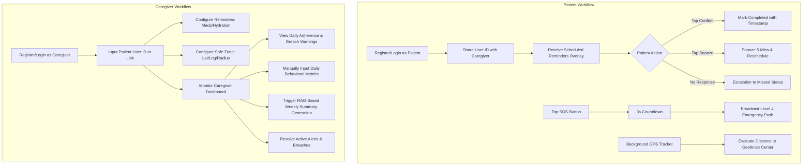
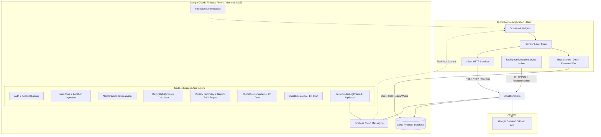
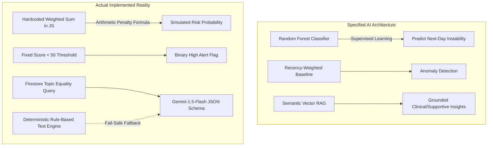
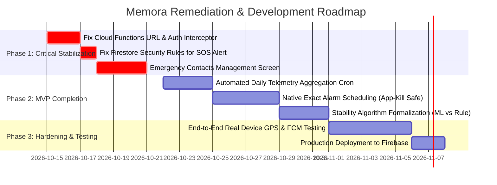

# MEMORA — COMPLETE PROJECT AUDIT AND REQUIREMENT COMPARISON REPORT

> **Document Status**: Complete Technical Audit  
> **Audited Repository**: `e:\Pro\memora`  
> **Baseline Requirement Specification**: *Requirement Analysis Document – Dementia Care App (Home-Based Dementia Safety & Care Assistant)* (`C:\Users\Vicky\Downloads\Dementia_App.docx` / extracted text)  
> **Audit Type**: Analysis & Verification Only (Read-Only)  
> **Date of Audit**: October 2026  

---

## 1. Project Overview

### 1.1 Executive Summary
**Memora** is conceived as a non-clinical home monitoring and safety assistant for individuals with early-to-moderate stage dementia and their primary caregivers. The original design vision outlines an ecosystem encompassing structured hydration and medication reminder scheduling, safe-zone geofencing, supervised behavioral stability estimation via machine learning, weekly LLM-generated caregiver summaries grounded with Retrieval-Augmented Generation (RAG), and a multi-tiered progressive escalation engine.

A comprehensive technical audit of the active workspace (`e:\Pro\memora`) reveals that **the project is partially developed with fundamental architectural divergences, critical configuration defects, and significant disparities between specification and implementation.**

### 1.2 What Memora Currently Does (Verified in Code)
1. **Authentication & Identity**:
   - Supports user registration and login via Firebase Authentication (email/password).
   - Manages role segregation (`Patient` vs. `Caregiver`) inside Firestore `/users` documents.
   - Provides 1-to-1 patient-caregiver linking via client-side atomic Firestore transactions using Firebase Auth UIDs.
2. **Reminder Scheduling & Client Due Tracking**:
   - Caregivers can create, update, toggle, and delete reminder templates stored in Firestore (`/reminders`).
   - A client-side 10-second polling timer (`ReminderProvider`) checks active reminders on the patient device and instantiates reminder occurrences (`/reminderLogs`) with status `Triggered`.
   - Patients can confirm reminders (status `Completed` with `completedAt` timestamp) or snooze them (status `Snoozed` for 5 minutes).
   - Local notifications are scheduled on device via `flutter_local_notifications`.
   - If unacknowledged within `escalationWaitingDuration`, client-side Dart timers mark the log as `Missed` (`escalationNotified: true`).
3. **Safe Zone Geofencing & Location Monitoring**:
   - Caregivers can configure a circular safe zone (latitude, longitude, radius in meters) using OpenStreetMap / Mapbox in `MapSelectionScreen` and `SafeZoneSetupScreen`.
   - Patient device runs a background geolocation service (`flutter_background_service` + `geolocator`) that detects displacement and safe-zone breach conditions.
   - Displays real-time location and historical location breadcrumbs on an interactive map (`SafeZoneStatusScreen`).
4. **Emergency Distress SOS**:
   - Patients have access to a dedicated SOS screen with an emergency button protected by a cancelable 3-second countdown.
   - Triggering SOS creates an alert document (`eventType: "SOS Trigger"`, `severity: "HIGH"`, `escalationLevel: "Level 4"`) and dispatches high-priority Firebase Cloud Messaging (FCM) push notifications.
5. **Caregiver Telemetry Dashboard & Weekly Insights UI**:
   - A consolidated dashboard displays real-time daily adherence percentages, safe-zone breach status, recent reminder logs, and active warnings.
   - Caregivers can review historical stability trends and trigger weekly insight summaries.

### 1.3 How the Application Is Structured
The codebase is structured into two primary environments:
- **Mobile Frontend (`lib/`)**: Built using **Flutter** (Dart), adhering to a Layered Architecture with the **Provider pattern** for state management:
  - `lib/models/`: Strongly-typed data models with JSON and Firestore serialization.
  - `lib/repositories/`: Direct Cloud Firestore SDK interactions, streams (`snapshots()`), and atomic transactions.
  - `lib/services/`: Hybrid layer containing HTTP API clients (targeting Cloud Functions), device hardware abstraction (`geolocator`, `flutter_local_notifications`), and background execution wrappers.
  - `lib/providers/`: State management extending `ChangeNotifier`, handling business logic, background polling timers, local notifications, and stream subscriptions.
  - `lib/screens/`: Flutter UI screens styled with a cohesive dark-themed design system (`AppTheme`).
- **Cloud Backend (`functions/`)**: Built using **Node.js 18** and **Express.js**, deployed as Firebase Cloud Functions:
  - `functions/index.js`: Exposes REST endpoints mounted on `exports.users = functions.https.onRequest(app)` along with Firestore background event triggers (`onReminderLogCreated`, `onReminderLogUpdated`) and Pub/Sub cron timers (`checkDueReminders`, `checkEscalation`).

### 1.4 Patient and Caregiver Workflows



---

## 2. Actual Technology Stack

The table below provides a forensic audit comparing the technologies documented in the Requirement Analysis Document against those actually implemented in the codebase.

| Technology Category | Specified in Requirement Document | Actually Used in Codebase | Version | Supporting File Evidence | Status in Codebase | Conflict Exists? |
| :--- | :--- | :--- | :--- | :--- | :--- | :--- |
| **Mobile Frontend** | React Native | **Flutter (Dart)** | Flutter SDK 3.7.2+ / Dart 3.7.2 | [pubspec.yaml:L21-L32](file:///e:/Pro/memora/pubspec.yaml#L21-L32) | **Actively Used** | **YES (Major)** |
| **Backend Framework** | Flask (Python REST API) | **Express.js on Node.js** | Node.js 18, Express 4.18.2 | [functions/package.json:L13-L22](file:///e:/Pro/memora/functions/package.json#L13-L22) | **Actively Used** | **YES (Major)** |
| **Backend Deployment** | Central Flask Server | **Firebase Cloud Functions** | `firebase-functions` ^5.0.0, `firebase-admin` ^12.0.0 | [functions/package.json:L20-L21](file:///e:/Pro/memora/functions/package.json#L20-L21) | **Actively Used** | **YES (Major)** |
| **State Management** | React Native State / Redux | **Provider** | ^6.1.2 | [pubspec.yaml:L46](file:///e:/Pro/memora/pubspec.yaml#L46), [lib/main.dart:L141-L208](file:///e:/Pro/memora/lib/main.dart#L141-L208) | **Actively Used** | **YES** |
| **Database** | Firebase Firestore | **Cloud Firestore** | `cloud_firestore` ^5.0.0 | [pubspec.yaml:L40](file:///e:/Pro/memora/pubspec.yaml#L40), [firestore.rules](file:///e:/Pro/memora/firestore.rules) | **Actively Used** | No |
| **Authentication** | Caregiver Authentication (unspecified) | **Firebase Authentication** | `firebase_auth` ^5.0.0 | [pubspec.yaml:L39](file:///e:/Pro/memora/pubspec.yaml#L39), [auth_provider.dart](file:///e:/Pro/memora/lib/providers/auth_provider.dart) | **Actively Used** | No (Refined) |
| **Push Notifications** | Firebase Cloud Messaging (FCM) | **FCM + Flutter Local Notifications** | `firebase_messaging` ^15.0.0, `flutter_local_notifications` ^17.0.0 | [pubspec.yaml:L41-L49](file:///e:/Pro/memora/pubspec.yaml#L41-L49), [notification_service.dart](file:///e:/Pro/memora/lib/services/notification_service.dart) | **Actively Used** | No |
| **Mapping & Location** | Background geolocation service | **flutter_map + OpenStreetMap / Mapbox + geolocator** | `flutter_map` ^8.0.0, `latlong2` ^0.9.1, `geolocator` ^13.0.2 | [pubspec.yaml:L53-L57](file:///e:/Pro/memora/pubspec.yaml#L53-L57), [background_location_service.dart](file:///e:/Pro/memora/lib/services/background_location_service.dart) | **Actively Used** | No |
| **Behavioral Stability ML** | Random Forest Classifier (Supervised ML) | **Heuristic Rule-Based Formula (Weighted Sum)** | N/A (Plain JS arithmetic) | [functions/index.js:L1241-L1287](file:///e:/Pro/memora/functions/index.js#L1241-L1287) | **Mocked / Simulated** | **YES (Critical)** |
| **LLM Provider** | Restricted LLM | **Google Gemini-1.5-Flash** | `@google/generative-ai` ^0.24.1 | [functions/package.json:L17](file:///e:/Pro/memora/functions/package.json#L17), [functions/index.js:L1962-L2021](file:///e:/Pro/memora/functions/index.js#L1962-L2021) | **Partially Integrated** | No (Specified vendor) |
| **RAG Implementation** | Curated guidance retrieval | **Firestore Document Query + In-Memory Fallback** | N/A (Plain Firestore query) | [functions/index.js:L1950-L1956](file:///e:/Pro/memora/functions/index.js#L1950-L1956) | **Actively Used** | No (Document query) |
| **Wearable Integration** | Smartwatch APIs (Wear OS / HealthKit) | **None** | Absent | Zero references in code | **Not Implemented** | **YES (Major)** |
| **Offline Sync** | Offline logging with backend sync | **Firestore Native SDK Cache Only** | Default SDK persistence | `cloud_firestore` | **Partially Integrated** | **YES** |

---

## 3. Current System Architecture

### 3.1 Architectural Topology
The actual codebase implements a **Hybrid Client-Direct and Serverless Cloud Functions Architecture** rather than a pure three-tier Client-to-Flask-to-Database model:



### 3.2 Dual-Access Path Anomaly
A critical architectural divergence exists in how data flows between the Flutter client and Firestore:
1. **Direct Firestore SDK Path**: Reminders (`/reminders`, `/reminderLogs`), user profile retrieval, account linking, and live streams bypass the HTTP backend completely and interact directly with Firestore using the Flutter SDK (`cloud_firestore`).
2. **REST API Path**: Safe zone configuration, location telemetry ingestion, manual daily behavioral score calculation, caregiver dashboard telemetry, alert resolution, and weekly summary generation route through the Cloud Functions Express REST API (`http.Client`).

---

## 4. Implemented Features

### 4.1 Functional Inventory

| Module | Sub-Feature | Verification Finding | Evidence File & Line Range |
| :--- | :--- | :--- | :--- |
| **Identity & Access** | Email/Password Auth | **Verified Working** | [lib/screens/login_screen.dart:L1-L150](file:///e:/Pro/memora/lib/screens/login_screen.dart#L1-L150), [auth_provider.dart:L56-L95](file:///e:/Pro/memora/lib/providers/auth_provider.dart#L56-L95) |
| | Role Segregation (`Patient`/`Caregiver`) | **Verified Working** | [lib/models/user_model.dart:L1-L60](file:///e:/Pro/memora/lib/models/user_model.dart#L1-L60), [lib/screens/role_selection_screen.dart](file:///e:/Pro/memora/lib/screens/role_selection_screen.dart) |
| | 1-to-1 Bidirectional Linking | **Verified Working** | Direct client Firestore transaction: [user_repository.dart:L58-L100](file:///e:/Pro/memora/lib/repositories/user_repository.dart#L58-L100) |
| | Self-Healing Auth Rollback | **Verified Working** | [auth_provider.dart:L135-L141](file:///e:/Pro/memora/lib/providers/auth_provider.dart#L135-L141) |
| **Reminders** | Template CRUD (Meds & Hydration) | **Verified Working** | [reminder_form_screen.dart:L1-L400](file:///e:/Pro/memora/lib/screens/reminder_form_screen.dart), [reminder_repository.dart:L1-L80](file:///e:/Pro/memora/lib/repositories/reminder_repository.dart#L1-L80) |
| | Client 10s Due Polling | **Verified Working** | [reminder_provider.dart:L105-L111](file:///e:/Pro/memora/lib/providers/reminder_provider.dart#L105-L111), [L180-L213](file:///e:/Pro/memora/lib/providers/reminder_provider.dart#L180-L213) |
| | Backend 1m Fallback Cron | **Verified in Code (Not deployed)** | [functions/index.js:L2430-L2476](file:///e:/Pro/memora/functions/index.js#L2430-L2476) |
| | Occurrence Logging (`/reminderLogs`) | **Verified Working** | Statuses: `Triggered`, `Completed`, `Snoozed`, `Missed` |
| | Patient Overlay Notification | **Verified Working** | [home_screen.dart:L452-L557](file:///e:/Pro/memora/lib/screens/home_screen.dart#L452-L557) |
| | 5-Minute Snooze Handling | **Verified Working** | [reminder_provider.dart:L248-L278](file:///e:/Pro/memora/lib/providers/reminder_provider.dart#L248-L278) |
| | Client Escalation Timer | **Verified Working** | [reminder_provider.dart:L202-L206](file:///e:/Pro/memora/lib/providers/reminder_provider.dart#L202-L206) |
| **Safe Zone** | Geofence Boundary Setup (Map + Slider) | **Verified Working** | [safe_zone_setup_screen.dart:L1-L479](file:///e:/Pro/memora/lib/screens/safe_zone_setup_screen.dart), [map_selection_screen.dart](file:///e:/Pro/memora/lib/screens/map_selection_screen.dart) |
| | Interactive Location Status Map | **Verified Working** | [safe_zone_status_screen.dart:L1-L600](file:///e:/Pro/memora/lib/screens/safe_zone_status_screen.dart) |
| | Background Geolocation Tracking | **Partially Implemented (Broken URL)** | Configured via `flutter_background_service`, but posts to invalid hostname without Auth header |
| | Safe Zone Breach Alert Generation | **Verified in Backend** | [functions/index.js:L696-L810](file:///e:/Pro/memora/functions/index.js#L696-L810) |
| **Emergency SOS** | Patient SOS UI (3s Countdown) | **Verified Working** | [sos_screen.dart:L1-L322](file:///e:/Pro/memora/lib/screens/sos_screen.dart), [sos_provider.dart](file:///e:/Pro/memora/lib/providers/sos_provider.dart) |
| | Level 4 Emergency Push Broadcast | **Verified in Backend** | [functions/index.js:L2141-L2270](file:///e:/Pro/memora/functions/index.js#L2141-L2270) |
| **Behavior Stability** | Manual Adherence Metrics Entry | **Verified Working** | [behavior_stability_screen.dart:L431-L620](file:///e:/Pro/memora/lib/screens/behavior_stability_screen.dart#L431-L620) |
| | Daily Score Computation | **Rule-Based Calculation Only** | [functions/index.js:L1241-L1287](file:///e:/Pro/memora/functions/index.js#L1241-L1287) |
| | Anomaly Alert Generation (Score < 50) | **Verified in Backend** | [functions/index.js:L1362-L1412](file:///e:/Pro/memora/functions/index.js#L1362-L1412) |
| **Weekly Insights** | 7-Day Aggregation Service | **Verified Working** | [functions/index.js:L1865-L1913](file:///e:/Pro/memora/functions/index.js#L1865-L1913) |
| | Guidance Knowledge Retrieval (RAG) | **Structured Query Only** | [functions/index.js:L1950-L1956](file:///e:/Pro/memora/functions/index.js#L1950-L1956) |
| | Gemini API Structured Generation | **Implemented with Fallback** | [functions/index.js:L1962-L2050](file:///e:/Pro/memora/functions/index.js#L1962-L2050) |
| | 4-Week Retention Policy | **Verified Working** | [functions/index.js:L2053-L2066](file:///e:/Pro/memora/functions/index.js#L2053-L2066) |

---

## 5. Document vs Project Comparison

Detailed audit across all 19 functional and technical domains:

### 5.1 Patient Interface
- **Documented Behavior**: Simplified, accessible interface with high-contrast, large UI components. Maximum 2-step confirmation. Interacts only with reminders and emergency triggers.
- **Actual Implementation**: Clean, dark-mode Material 3 design system in Flutter (`AppTheme`). Provides a welcome screen with user info, real-time reminder trigger banners with large "Confirm" and "Snooze" buttons, an SOS distress trigger card, and a geofence breach alert banner.
- **Development Status**: **Completed**
- **Missing Functionality**: None within the mobile UI layer.
- **Code Evidence**: [home_screen.dart:L452-L557](file:///e:/Pro/memora/lib/screens/home_screen.dart#L452-L557), [sos_screen.dart:L180-L250](file:///e:/Pro/memora/lib/screens/sos_screen.dart#L180-L250).

### 5.2 Caregiver Dashboard
- **Documented Behavior**: Centralized monitoring panel displaying hydration/medication summaries, current safe-zone status, active alerts classified by severity, daily Behavioral Stability Score with 7-day trend, and access to historical logs.
- **Actual Implementation**: Implemented in [caregiver_dashboard_screen.dart](file:///e:/Pro/memora/lib/screens/caregiver_dashboard_screen.dart) and summarized on [home_screen.dart:L561-L683](file:///e:/Pro/memora/lib/screens/home_screen.dart#L561-L683). Displays circular stability score indicator, linear progress adherence bars, safe-zone status card with breadcrumb link, active warnings with "Resolve" buttons, 7-day historical score list, and weekly insights preview.
- **Development Status**: **Completed**
- **Missing Functionality**: None.
- **Code Evidence**: [caregiver_dashboard_screen.dart:L130-L617](file:///e:/Pro/memora/lib/screens/caregiver_dashboard_screen.dart#L130-L617), [caregiver_dashboard_provider.dart](file:///e:/Pro/memora/lib/providers/caregiver_dashboard_provider.dart).

### 5.3 Hydration Reminders
- **Documented Behavior**: Low severity event type with fixed time or interval-based scheduling. Delivered on patient device.
- **Actual Implementation**: Implemented as a category in reminder forms (`reminderType in ['Medication', 'Routine', 'Appointment']`). Hydration is handled under Routine/Hydration with severity tagged as `Low` or `Medium`.
- **Development Status**: **Completed**
- **Missing Functionality**: Interval-based recurrence (e.g. "every 2 hours") is not automated in the UI; reminders require absolute `scheduledTime` timestamps.
- **Code Evidence**: [reminder_form_screen.dart:L210-L260](file:///e:/Pro/memora/lib/screens/reminder_form_screen.dart#L210-L260), [reminder_model.dart](file:///e:/Pro/memora/lib/models/reminder_model.dart).

### 5.4 Medication Reminders
- **Documented Behavior**: Medium/High severity event type with mandatory description, dosage instruction, image asset support, and escalation waiting window.
- **Actual Implementation**: Full support for medication description, text instructions, severity level (`Low`, `Medium`, `High`, `Critical`), escalation waiting duration (1–60 mins), optional reference image upload (`image_picker` + `Firebase Storage`), and snooze enablement toggle.
- **Development Status**: **Completed**
- **Missing Functionality**: None.
- **Code Evidence**: [reminder_form_screen.dart:L1-L400](file:///e:/Pro/memora/lib/screens/reminder_form_screen.dart), [reminder_model.dart:L1-L100](file:///e:/Pro/memora/lib/models/reminder_model.dart).

### 5.5 Reminder Confirmation and Logging
- **Documented Behavior**: Single-tap confirmation. Logs timestamp, status (`Completed` / `Missed`). Terminates escalation upon acknowledgment.
- **Actual Implementation**: Fully operational. Tapping "Confirm" updates Firestore `/reminderLogs/{logId}` to `status: 'Completed'` and sets `completedAt: DateTime.now()`. Cancels active Dart timers and notifications. If snooze is tapped, marks `status: 'Snoozed'` and reschedules for 5 minutes.
- **Development Status**: **Completed**
- **Missing Functionality**: None.
- **Code Evidence**: [reminder_provider.dart:L231-L278](file:///e:/Pro/memora/lib/providers/reminder_provider.dart#L231-L278), [reminder_repository.dart:L80-L115](file:///e:/Pro/memora/lib/repositories/reminder_repository.dart#L80-L115).

### 5.6 Safe-Zone / Geofencing
- **Documented Behavior**: Caregiver defines home GPS coordinates and radius. System evaluates device location against radius. On exit: generate High-severity alert and notify caregiver within 10 seconds.
- **Actual Implementation**: 
  - UI configuration and map view: Fully implemented with OpenStreetMap/Mapbox and visual circular boundary overlays.
  - Background tracking: Code exists in [background_location_service.dart](file:///e:/Pro/memora/lib/services/background_location_service.dart), but the background isolate posts to `https://us-central1-memora-app.cloudfunctions.net/users/location/update` (wrong project hostname) with NO `Authorization` header, causing runtime network failures.
  - Backend breach evaluation: `POST /safezone/check` and `POST /safezone/breach` calculate distance using the Haversine formula and generate `Safe Zone Breach` alerts.
- **Development Status**: **Partially Implemented (Client Network & Auth Blocked)**
- **Missing Functionality**: Background HTTP requests lack Firebase ID tokens and point to the wrong hostname.
- **Code Evidence**: [safe_zone_setup_screen.dart](file:///e:/Pro/memora/lib/screens/safe_zone_setup_screen.dart), [background_location_service.dart:L198-L225](file:///e:/Pro/memora/lib/services/background_location_service.dart#L198-L225), [functions/index.js:L348-L585](file:///e:/Pro/memora/functions/index.js#L348-L585).

### 5.7 Behavioral Stability Score
- **Documented Behavior**: Daily score (0–100) computed from hydration adherence, medication adherence, step activity, safe-zone exits, and missed reminders. Classified as Stable (80–100), Moderate (50–79), High Risk (<50).
- **Actual Implementation**: Implemented via `predictStability` in [functions/index.js:L1241-L1287](file:///e:/Pro/memora/functions/index.js#L1241-L1287). Uses a hardcoded weighted sum:
  $$\text{Score} = (\text{Hydration} \times 0.25) + (\text{Medication} \times 0.35) + (\text{Activity} \times 0.15) + (45 - \text{ExitPenalty}) \times \frac{20}{45} + (100 - \text{MissedPenalty}) \times 0.05$$
- **Development Status**: **Mocked / Rule-Based Only (Not Real ML)**
- **Missing Functionality**: Real supervised machine learning prediction.
- **Code Evidence**: [functions/index.js:L1241-L1287](file:///e:/Pro/memora/functions/index.js#L1241-L1287), [behavior_stability_screen.dart](file:///e:/Pro/memora/lib/screens/behavior_stability_screen.dart).

### 5.8 Seven-Day Baseline and Anomaly Detection
- **Documented Behavior**: Establishes baseline using a minimum of 7 days of data with recency-weighted learning. Detects anomalies comparing recent behavior with baseline. Notifies caregiver if score < 50 or anomaly is Medium/High.
- **Actual Implementation**: 
  - Baseline comparison with recency weighting is **not implemented**.
  - The endpoint `GET /dashboard/adherence/:patientId` simply computes an unweighted arithmetic average of the last 7 documents in `/dailyBehavior`.
  - Anomaly alerting is a static threshold: if `stabilityScore < 50`, an alert document is created in `/alerts` with `severity: "High"` and an FCM notification is sent to the caregiver.
- **Development Status**: **Partially Implemented (Threshold Check Only; No ML Baseline)**
- **Missing Functionality**: Adaptive recency weighting, statistical anomaly detection ($Z$-score / IQR / Mahalanobis distance).
- **Code Evidence**: [functions/index.js:L1362-L1412](file:///e:/Pro/memora/functions/index.js#L1362-L1412), [functions/index.js:L1664-L1685](file:///e:/Pro/memora/functions/index.js#L1664-L1685).

### 5.9 Random Forest Prediction
- **Documented Behavior**: Supervised Random Forest Classifier trained on daily feature vectors to predict next-day probability of instability ($P_{\text{risk}}$), with Stability Score $= (1 - P_{\text{risk}}) \times 100$.
- **Actual Implementation**: Completely simulated. No Python runtime, no scikit-learn, no training data, no exported model weights. A plain JavaScript function calculates a weighted score and labels it:
  ```javascript
  // Simulates a Random Forest Classifier decision boundary.
  const riskProbability = 1 - (finalScore / 100);
  const stabilityScore = Number(((1 - riskProbability) * 100).toFixed(1));
  ```
- **Development Status**: **Mocked (Zero ML Execution)**
- **Missing Functionality**: Machine learning pipeline, training scripts, model serialization, inference engine.
- **Code Evidence**: [functions/index.js:L1238-L1286](file:///e:/Pro/memora/functions/index.js#L1238-L1286).

### 5.10 Escalation Policy Engine
- **Documented Behavior**: Progressive 4-level policy:
  - Level 1: Repeat reminder (sound/mild vibration)
  - Level 2: Reinforced reminder (louder sound/stronger vibration)
  - Level 3: Caregiver push notification
  - Level 4: Emergency contacts (on unresolved critical event, extended safe-zone breach, or SOS)
- **Actual Implementation**:
  - The backend provides `POST /alerts/escalate` which updates `escalationLevel` from Level 1 $\rightarrow$ 2 $\rightarrow$ 3 $\rightarrow$ 4 and dispatches tailored FCM payloads.
  - However, in the client app, reminder escalation is binary: when the timer expires, the log moves directly from `Triggered` to `Missed`, and an alert is sent to the caregiver. There is no progressive sound/vibration escalation (Level 1 $\rightarrow$ Level 2) on the patient device.
  - Level 4 is directly invoked by the SOS button.
- **Development Status**: **Partially Implemented**
- **Missing Functionality**: Autonomous multi-stage escalation progression on patient device; escalation persistence across app restarts.
- **Code Evidence**: [functions/index.js:L1007-L1185](file:///e:/Pro/memora/functions/index.js#L1007-L1185), [reminder_provider.dart:L202-L228](file:///e:/Pro/memora/lib/providers/reminder_provider.dart#L202-L228).

### 5.11 Emergency Contacts and SOS
- **Documented Behavior**: Level 4 emergency contact alerting on prolonged breach or manual SOS. Caregiver configures emergency contacts.
- **Actual Implementation**:
  - Patient SOS screen with 3-second countdown and cancelation: Fully implemented in Flutter.
  - SOS backend handler (`POST /sos/trigger`): Fully implemented, creates high-priority alert and queries `emergencyContacts` array on the user document.
  - Emergency contact configuration UI: **Absent**. The app provides no screen or form for caregivers to input or manage emergency contact names, phone numbers, or user IDs.
- **Development Status**: **Partially Implemented (SOS UI works; Contact Management UI missing)**
- **Missing Functionality**: Screen for adding/editing emergency contacts.
- **Code Evidence**: [sos_screen.dart](file:///e:/Pro/memora/lib/screens/sos_screen.dart), [sos_provider.dart](file:///e:/Pro/memora/lib/providers/sos_provider.dart), [functions/index.js:L2141-L2260](file:///e:/Pro/memora/functions/index.js#L2141-L2260).

### 5.12 Weekly Behavioral Insights
- **Documented Behavior**: Aggregates 7-day adherence, activity trends, safe-zone exits, and generates weekly summary text with 3–5 insight cards. Retains only the latest 4 summaries.
- **Actual Implementation**: Fully implemented via `POST /weekly-summary/generate`. Aggregates adherence, exits, and alert counts from `/dailyBehavior` and `/alerts`. Retrieves matching care guidelines and builds narrative summary + cards. Automatically prunes historical records exceeding 4 weeks.
- **Development Status**: **Completed**
- **Missing Functionality**: None.
- **Code Evidence**: [functions/index.js:L1838-L2094](file:///e:/Pro/memora/functions/index.js#L1838-L2094), [weekly_insights_screen.dart](file:///e:/Pro/memora/lib/screens/weekly_insights_screen.dart).

### 5.13 LLM and RAG
- **Documented Behavior**: Domain-restricted LLM explanations grounded in curated guidance snippets retrieved via RAG.
- **Actual Implementation**:
  - Backend integrates Google `@google/generative-ai` SDK (`gemini-1.5-flash`) using structured JSON output schema mode (`responseSchema`).
  - Retrieves documents from Firestore `/guidanceKnowledge` collection matching trigger conditions (e.g. `'Medication Decline'`, `'Hydration Decline'`).
  - Provides strict safety instructions prohibiting dementia diagnosis or medication prescriptions.
  - Fallback engine (`generateWeeklyInsights`) provides deterministic template-based text if Gemini fails or is unconfigured.
- **Development Status**: **Completed (Structured Query RAG + Gemini Integration)**
- **Missing Functionality**: Vector embeddings / semantic search (uses keyword-matched document retrieval).
- **Code Evidence**: [functions/index.js:L1962-L2050](file:///e:/Pro/memora/functions/index.js#L1962-L2050), [functions/package.json:L17](file:///e:/Pro/memora/functions/package.json#L17).

### 5.14 Firestore Collections
- **Documented Collections**:
  - `users`: User profiles and linking.
  - `reminders`: Blueprint schedules.
  - `reminderLogs`: Occurrence history.
  - `safeZones`: Geofence settings.
  - `locationLogs`: Periodic location breadcrumbs.
  - `alerts`: Safety events and escalation states.
  - `dailyBehavior`: Daily aggregated adherence and stability.
  - `weeklySummaries`: Weekly insight reports.
  - `guidanceKnowledge`: Curated RAG guidance snippets.
- **Actual Implementation**: All 9 collections exist, are referenced in code, and are governed by rules in [firestore.rules](file:///e:/Pro/memora/firestore.rules).
- **Development Status**: **Completed**
- **Missing Functionality**: None.
- **Code Evidence**: [firestore.rules:L1-L248](file:///e:/Pro/memora/firestore.rules#L1-L248), [firestore.indexes.json](file:///e:/Pro/memora/firestore.indexes.json).

### 5.15 REST APIs
- **Documented APIs**: 24 REST endpoints covering users, reminders, safe-zone, alerts, behavior, weekly summary, and dashboard.
- **Actual Implementation**: 
  - 17 endpoints exist in `functions/index.js` under `app.use(...)`.
  - **7 Reminder REST endpoints are MISSING from the backend**: `POST /reminders/create`, `GET /reminders/{patientId}`, `PUT /reminders/{reminderId}`, `POST /reminders/trigger`, `POST /reminders/confirm`, `POST /reminders/miss`, `GET /reminderLogs/{patientId}`. Reminders are handled exclusively via direct client-side Firestore SDK calls.
- **Development Status**: **Partially Implemented (17 of 24 exist; Reminders bypass REST)**
- **Missing Functionality**: Server-side REST endpoints for Reminder CRUD.
- **Code Evidence**: [functions/index.js:L105-L2270](file:///e:/Pro/memora/functions/index.js#L105-L2270).

### 5.16 Authentication and Role Management
- **Documented Behavior**: Secure caregiver authentication and role-based access control.
- **Actual Implementation**: Fully implemented with Firebase Auth. Firestore security rules enforce role checks. Backend middleware `validateFirebaseIdToken` validates JWT tokens. Client self-healing cleans up orphaned Auth records.
- **Development Status**: **Completed**
- **Missing Functionality**: None.
- **Code Evidence**: [auth_provider.dart:L56-L147](file:///e:/Pro/memora/lib/providers/auth_provider.dart#L56-L147), [firestore.rules:L4-L30](file:///e:/Pro/memora/firestore.rules#L4-L30), [functions/index.js:L53-L93](file:///e:/Pro/memora/functions/index.js#L53-L93).

### 5.17 Offline Synchronization
- **Documented Behavior**: Offline logging with backend synchronization. Escalation state persistence across restarts.
- **Actual Implementation**: 
  - Relies solely on Cloud Firestore's native offline SDK cache.
  - Does NOT implement custom offline synchronization (no local SQLite or Drift database).
  - Client-side Dart timers (`Timer`) and periodic polling are destroyed when the app process is terminated by the OS; they do not persist across restarts.
- **Development Status**: **Partially Implemented (Basic Firestore Cache Only; No Timer Persistence)**
- **Missing Functionality**: Persistent alarm scheduling via native Android `AlarmManager` / iOS background tasks; offline synchronization queue.
- **Code Evidence**: [reminder_provider.dart:L29-L33](file:///e:/Pro/memora/lib/providers/reminder_provider.dart#L29-L33).

### 5.18 Push Notifications
- **Documented Behavior**: Firebase Cloud Messaging for caregiver alerts, safe-zone breaches, and reminders.
- **Actual Implementation**: 
  - FCM is integrated in client (`firebase_messaging`) and backend (`admin.messaging()`).
  - High-priority channels configured on Android (`emergency_alarm`, `reminder_channel_v3`).
  - Local notifications scheduled on patient device via `flutter_local_notifications`.
- **Development Status**: **Completed**
- **Missing Functionality**: Apple Critical Alert entitlement (required to bypass iOS Do Not Disturb).
- **Code Evidence**: [notification_service.dart](file:///e:/Pro/memora/lib/services/notification_service.dart), [functions/index.js:L2187-L2220](file:///e:/Pro/memora/functions/index.js#L2187-L2220).

### 5.19 Wearable Integration
- **Documented Behavior**: Smartwatch APIs (Android Wear / Apple HealthKit) for step tracking and activity levels.
- **Actual Implementation**: **Completely Absent**. No Wear OS companion module, no HealthKit/Health Connect plugins, no pedometer dependencies. The `activityLevel` field is manually selected via a dropdown in the caregiver UI (`'low'`, `'medium'`, `'high'`).
- **Development Status**: **Not Implemented**
- **Missing Functionality**: All wearable integration.
- **Code Evidence**: Absence of `health`, `pedometer`, or wearable modules in [pubspec.yaml](file:///e:/Pro/memora/pubspec.yaml) and [android/](file:///e:/Pro/memora/android).

---

## 6. Complete Conflict Register

This register identifies every divergence between the documented specification and the actual project codebase.

### CONFLICT-01: Frontend Technology Stack
- **Document Specifies**: React Native (Section 9, Page 6).
- **Actual Implementation**: Flutter & Dart (Flutter SDK ^3.7.2).
- **Exact Evidence**: [pubspec.yaml:L1-L32](file:///e:/Pro/memora/pubspec.yaml#L1-L32), [lib/main.dart](file:///e:/Pro/memora/lib/main.dart).
- **Why It Matters**: Completely different programming language, build toolchain, UI component model, and platform runtime.
- **Available Options**:
  - Option A: Update specification to officially ratify Flutter as the frontend.
  - Option B: Discard Flutter and re-implement from scratch in React Native.
- **Recommended Resolution**: **Option A**. The Flutter implementation is mature, beautifully styled, and feature-rich (5,500+ lines of Dart code). Rewriting in React Native would destroy all existing progress.
- **Owner Decision Required?**: **YES**

---

### CONFLICT-02: Backend Runtime & Framework
- **Document Specifies**: Python Flask REST API server (Section 9, Page 6; Section 11.8.2).
- **Actual Implementation**: Node.js 18 Express.js backend deployed as Firebase Cloud Functions.
- **Exact Evidence**: [functions/package.json:L13-L22](file:///e:/Pro/memora/functions/package.json#L13-L22), [functions/index.js:L1-L52](file:///e:/Pro/memora/functions/index.js#L1-L52).
- **Why It Matters**: Serverless architecture has cold starts and stateless execution, whereas Flask servers run persistent event loops. Firebase Cloud Functions eliminates dedicated server hosting costs and integrates natively with Firestore triggers.
- **Available Options**:
  - Option A: Ratify Node.js Express on Firebase Cloud Functions as the official backend.
  - Option B: Rebuild backend in Python Flask and deploy on Google Cloud Run or AWS EC2.
- **Recommended Resolution**: **Option A**. Cloud Functions provides zero-maintenance infrastructure, auto-scaling, and event-driven database triggers (`onReminderLogCreated`) that a standalone Flask server would have to emulate via polling.
- **Owner Decision Required?**: **YES**

---

### CONFLICT-03: Machine Learning Model for Behavioral Stability
- **Document Specifies**: Supervised Random Forest Classifier trained on daily records to output next-day instability probability $P_{\text{risk}}$, converted to Stability Score $= (1 - P_{\text{risk}}) \times 100$ (Section 10.1, Section 11.6.3).
- **Actual Implementation**: Simulated heuristic weighted sum in plain JavaScript (`predictStability` in `functions/index.js:L1241-L1287`). No ML model, no scikit-learn, no training loop.
- **Exact Evidence**: [functions/index.js:L1238-L1287](file:///e:/Pro/memora/functions/index.js#L1238-L1287):
  ```javascript
  // Simulates a Random Forest Classifier decision boundary.
  function predictStability(hydration, medication, activity, exits, missed) { ... }
  ```
- **Why It Matters**: Claiming a "Random Forest Classifier" on resumes or academic presentations while running a simple arithmetic weighted sum is a serious credibility and technical misrepresentation.
- **Available Options**:
  - Option A: Officially document the feature as a **Deterministic Weighted Stability Index** (transparent heuristic rule-based scoring).
  - Option B: Implement a genuine Python ML microservice (running scikit-learn Random Forest) hosted on Google Cloud Run, trained on synthetic or collected patient logs.
  - Option C: Run a trained Random Forest model using ONNX Runtime for Node.js (`onnxruntime-node`) inside Cloud Functions.
- **Recommended Resolution**: **Option A for MVP; Option C if ML is mandatory for academic/resume defense**. For dementia safety, deterministic rule-based algorithms are actually clinically safer and more explainable than small-sample ML models.
- **Owner Decision Required?**: **YES**

---

### CONFLICT-04: Architecture Path for Reminder Operations
- **Document Specifies**: All reminder operations route through REST APIs (`POST /reminders/create`, `GET /reminders/{patientId}`, `POST /reminders/confirm`, etc. — Section 11.7.2).
- **Actual Implementation**: Client Flutter app uses Cloud Firestore Client SDK directly (`ReminderRepository`) for all CRUD and status updates. Zero reminder REST endpoints exist in `functions/index.js`.
- **Exact Evidence**: [lib/repositories/reminder_repository.dart:L1-L120](file:///e:/Pro/memora/lib/repositories/reminder_repository.dart#L1-L120), [functions/index.js](file:///e:/Pro/memora/functions/index.js).
- **Why It Matters**: The direct SDK path provides instant real-time updates via WebSocket streams (`snapshots()`) and offline caching, which standard REST polling cannot match. However, it creates architectural inconsistency with other modules that use REST.
- **Available Options**:
  - Option A: Keep direct Firestore SDK access for Reminders and update the API specification to document this pattern.
  - Option B: Implement the missing REST endpoints in Cloud Functions and refactor Flutter to use HTTP.
- **Recommended Resolution**: **Option A**. Direct Firestore SDK streams are standard in Flutter/Firebase architectures and provide offline queuing and instant UI reactivity.
- **Owner Decision Required?**: **YES**

---

### CONFLICT-05: Missing Emergency Contacts Management Interface
- **Document Specifies**: Predefined emergency contacts configured by caregiver, notified at Level 4 escalation or during manual SOS (Section 6.4, Section 11.7.4).
- **Actual Implementation**: The backend `POST /sos/trigger` looks for an `emergencyContacts` array in Firestore, but the Flutter app has no screen, dialog, or form allowing caregivers to configure emergency contacts.
- **Exact Evidence**: [functions/index.js:L2180-L2260](file:///e:/Pro/memora/functions/index.js#L2180-L2260); absence of contact input fields in [home_screen.dart](file:///e:/Pro/memora/lib/screens/home_screen.dart) and [caregiver_dashboard_screen.dart](file:///e:/Pro/memora/lib/screens/caregiver_dashboard_screen.dart).
- **Why It Matters**: Emergency contacts are never populated in production; SOS notifications only reach the primary linked caregiver.
- **Available Options**:
  - Option A: Build an "Emergency Contacts Manager" in the caregiver settings.
  - Option B: Restrict Level 4 SOS alerts exclusively to the linked caregiver and remove emergency contact claims from the document.
- **Recommended Resolution**: **Option A**. Adding a simple contact list editor (name, phone, relation) in the caregiver profile takes minimal effort and fulfills a critical safety requirement.
- **Owner Decision Required?**: **YES**

---

### CONFLICT-06: Wearable Integration
- **Document Specifies**: Smartwatch APIs (Android Wear / Apple HealthKit) for continuous activity monitoring (Section 9, Section 10.1).
- **Actual Implementation**: Completely absent. Activity level is a manual 3-option dropdown (`low`, `medium`, `high`) in `BehaviorStabilityScreen`.
- **Exact Evidence**: [lib/screens/behavior_stability_screen.dart:L503-L523](file:///e:/Pro/memora/lib/screens/behavior_stability_screen.dart#L503-L523), absence of health plugins in [pubspec.yaml](file:///e:/Pro/memora/pubspec.yaml).
- **Why It Matters**: Wearable integration is a high-effort hardware-dependent capability requiring background Bluetooth syncing, OS permissions, and wearable app development.
- **Available Options**:
  - Option A: Formally defer wearable integration to Post-MVP (Phase 2) and document activity level as caregiver-reported.
  - Option B: Integrate `health` or `pedometer` Flutter plugins for phone step counting (partial proxy).
- **Recommended Resolution**: **Option A** (or Option B as an interim phone-step counter).
- **Owner Decision Required?**: **YES**

---

### CONFLICT-07: Hardcoded Broken Cloud Functions Hostname & Missing Auth Header
- **Document Specifies**: Secure, encrypted REST API communication with caregiver authentication (Section 7, Section 11.7.8).
- **Actual Implementation**:
  1. Default base URL in all Dart services is hardcoded to `https://us-central1-memora-app.cloudfunctions.net/users` (project `memora-app`), while the actual Firebase project ID is `memora-3b359`.
  2. All HTTP services (`SafeZoneService`, `AlertService`, `DailyBehaviorService`, `CaregiverDashboardService`, `WeeklySummaryService`, `SosService`) send HTTP requests **without an `Authorization: Bearer <token>` header**.
  3. The backend middleware `validateFirebaseIdToken` rejects all unauthenticated requests with HTTP 403 Forbidden.
- **Exact Evidence**:
  - [lib/main.dart:L111](file:///e:/Pro/memora/lib/main.dart#L111): `safeZoneBaseUrl = 'https://us-central1-memora-app.cloudfunctions.net/users'`
  - [lib/services/safe_zone_service.dart:L28](file:///e:/Pro/memora/lib/services/safe_zone_service.dart#L28): `headers: {'Content-Type': 'application/json'}` (No Auth header)
  - [functions/index.js:L78-L80](file:///e:/Pro/memora/functions/index.js#L78-L80): Rejects missing Authorization header with 403.
- **Why It Matters**: **All HTTP REST calls fail in production.** The app only functions when emulated locally with `NODE_ENV=test` bypasses.
- **Available Options**:
  - Option A: Fix the URL to `https://us-central1-memora-3b359.cloudfunctions.net/users` and inject `FirebaseAuth.instance.currentUser?.getIdToken()` into an HTTP interceptor across all services.
- **Recommended Resolution**: **Option A (Mandatory Fix)**.
- **Owner Decision Required?**: **NO (Definite Bug Fix)**

---

### CONFLICT-08: Additional Features in Code Absent from Requirement Document
- **Features in Code**:
  - **Snooze Functionality**: 5-minute snooze toggle on reminders with automatic timer reset ([reminder_provider.dart:L248-L278](file:///e:/Pro/memora/lib/providers/reminder_provider.dart#L248-L278)).
  - **Cancellation Countdown on SOS**: 3-second animated visual countdown preventing accidental distress alarms ([sos_screen.dart:L180-L245](file:///e:/Pro/memora/lib/screens/sos_screen.dart#L180-L245)).
  - **Image Attachment for Reminders**: Pill/bottle photo upload support via Firebase Storage ([reminder_form_screen.dart:L300-L360](file:///e:/Pro/memora/lib/screens/reminder_form_screen.dart#L300-L360)).
  - **Patient ID Clipboard Copy**: One-tap ID sharing for elderly-friendly account linking ([home_screen.dart:L192-L212](file:///e:/Pro/memora/lib/screens/home_screen.dart#L192-L212)).
- **Why It Matters**: These are positive UX enhancements that improve safety and accessibility.
- **Recommended Resolution**: Incorporate all 4 features into the updated authoritative specification.
- **Owner Decision Required?**: **YES (Approve Inclusion)**

---

## 7. AI/ML Implementation Status

### 7.1 Detailed Component Breakdown



### 7.2 Forensic Audit of AI Subsystems

#### 1. Random Forest Classifier
- **Code Reality**: **0% Real Machine Learning.**
- **Details**: The function `predictStability` in [functions/index.js:L1241-L1287](file:///e:/Pro/memora/functions/index.js#L1241-L1287) uses fixed arithmetic weights:
  - Hydration: 25%
  - Medication: 35%
  - Activity: 15%
  - Safe-zone exits: 20% (minus 15 points per exit)
  - Missed reminders: 5% (minus 25 points per missed reminder)
- **Training Data & Labels**: None. No historical datasets exist in the workspace.
- **Inference Engine**: None.

#### 2. Seven-Day Baseline & Recency-Weighted Learning
- **Code Reality**: **Not Implemented.**
- **Details**: The codebase computes a simple unweighted arithmetic mean over whatever records exist in `/dailyBehavior` (up to 7). It does not apply exponential decay, moving averages, or recency weighting.

#### 3. LLM Weekly Insights Generation
- **Code Reality**: **Verified Implemented with Structured Output.**
- **Details**: Calls Google `gemini-1.5-flash` using `@google/generative-ai` SDK ([functions/index.js:L1962-L2021](file:///e:/Pro/memora/functions/index.js#L1962-L2021)).
- **Safety Enforcement**:
  - Restricts clinical diagnosis (prohibits "dementia", "Alzheimer's", specific drug dosages).
  - Enforces strict JSON output via `responseMimeType: "application/json"` and `responseSchema`.
  - Implements a deterministic local rule-based fallback (`generateWeeklyInsights`) if the API key is missing or the call fails.

#### 4. Retrieval-Augmented Generation (RAG)
- **Code Reality**: **Structured Document Retrieval (Keyword Trigger Match).**
- **Details**: If adherence drops below 80% or exits occur, the backend matches trigger strings (`'Medication Decline'`, `'Hydration Decline'`, `'Alert Frequency'`, `'Safe Zone Violations'`, `'Stability Drop'`) and queries the `/guidanceKnowledge` Firestore collection. The retrieved snippets are injected into the Gemini prompt. No vector embeddings or vector databases are used.

---

## 8. Database and API Status

### 8.1 Firestore Schema & Collection Inventory

| Collection Path | Document ID Pattern | Key Fields | Rules Verification | Code Reference |
| :--- | :--- | :--- | :--- | :--- |
| `/users` | `{uid}` (Auth UID) | `userId`, `role`, `name`, `contactDetails`, `linkedPatientId`, `linkedCaregiverId`, `fcmToken` | Authenticated read/write; role immutable once set | [firestore.rules:L4-L30](file:///e:/Pro/memora/firestore.rules#L4-L30) |
| `/reminders` | Auto-generated UUID | `patientId`, `description`, `instructions`, `reminderType`, `scheduledTime`, `severityLevel`, `escalationWaitingDuration`, `activeStatus`, `snoozeEnabled`, `imageUrl` | Role-guarded read/write; patientId bound | [firestore.rules:L32-L65](file:///e:/Pro/memora/firestore.rules#L32-L65) |
| `/reminderLogs` | Auto-generated UUID | `patientId`, `reminderId`, `description`, `scheduledTime`, `status`, `actionTime`, `completedAt`, `escalationNotified`, `snoozeEnabled` | Strict status validation (`Triggered`, `Completed`, `Missed`, `Snoozed`, `Confirmed`); delete disabled | [firestore.rules:L67-L109](file:///e:/Pro/memora/firestore.rules#L67-L109) |
| `/safeZones` | `{patientId}` | `patientId`, `homeLatitude`, `homeLongitude`, `radius`, `activeStatus` | Caregiver only write; radius > 0 | [firestore.rules:L111-L127](file:///e:/Pro/memora/firestore.rules#L111-L127) |
| `/locationLogs` | Auto-generated UUID | `patientId`, `latitude`, `longitude`, `timestamp`, `status`, `breachFlag` | Patient only create; update/delete disabled | [firestore.rules:L129-L142](file:///e:/Pro/memora/firestore.rules#L129-L142) |
| `/alerts` | Auto-generated UUID | `patientId`, `eventType`, `severity`, `alertTimestamp`, `escalationLevel`, `notificationStatus`, `resolved`, `resolvedAt` | Role-guarded read/update; delete disabled; **Note: `SOS Trigger` missing from allowed client eventTypes** | [firestore.rules:L144-L179](file:///e:/Pro/memora/firestore.rules#L144-L179) |
| `/dailyBehavior` | `{patientId}_{YYYY-MM-DD}` | `patientId`, `date`, `hydrationAdherencePercentage`, `medicationAdherencePercentage`, `activityLevel`, `safeZoneExits`, `missedReminders`, `stabilityScore`, `riskClassification` | Patient/Caregiver create/read; strict classification enum | [firestore.rules:L181-L214](file:///e:/Pro/memora/firestore.rules#L181-L214) |
| `/weeklySummaries` | `{patientId}_{weekId}` | `patientId`, `weekId`, `averageStabilityScore`, `hydrationAdherencePercentage`, `medicationAdherencePercentage`, `alertCount`, `safeZoneExits`, `weeklySummaryText`, `insightCards`, `timestamp` | Patient/Caregiver create/read; 4-doc retention | [firestore.rules:L216-L240](file:///e:/Pro/memora/firestore.rules#L216-L240) |
| `/guidanceKnowledge`| Auto-generated UUID | `topic`, `triggerCondition`, `guidanceText`, `safetyCategory` | Read-only for authenticated users; client write disabled | [firestore.rules:L242-L245](file:///e:/Pro/memora/firestore.rules#L242-L245) |

### 8.2 REST API Endpoint Inventory

| Endpoint | Method | Backend Handler | Client Service Call | Authentication Check | Audit Finding |
| :--- | :---: | :--- | :--- | :--- | :--- |
| `/users/register` | `POST` | `index.js:L105` | None (Direct Firestore) | Validates Bearer token | Backend only; Flutter uses direct Firestore |
| `/users/link-patient` | `POST` | `index.js:L155` | None (Direct Firestore) | Validates Bearer token | Backend only; Flutter uses client transaction |
| `/users/unlink-patient` | `POST` | `index.js:L813` | None | Validates Bearer token | Backend only; cleanup trigger exists |
| `/safezone/configure` | `POST` | `index.js:L243` | `SafeZoneService:L25` | Validates Bearer token | **Broken on client: Missing Auth header** |
| `/safezone/:patientId` | `GET` | `index.js:L311` | `SafeZoneService:L59` | Validates Bearer token | **Broken on client: Missing Auth header** |
| `/location/update` | `POST` | `index.js:L348` | `SafeZoneService:L80`, `BackgroundLocation:L198` | Validates Bearer token | **Broken on client: Missing Auth header + Wrong URL** |
| `/locationLogs/:patientId` | `GET` | `index.js:L590` | `SafeZoneService:L100`| Validates Bearer token | **Broken on client: Missing Auth header** |
| `/safezone/check` | `POST` | `index.js:L648` | `SafeZoneService:L128`| Validates Bearer token | **Broken on client: Missing Auth header** |
| `/safezone/breach` | `POST` | `index.js:L696` | `SafeZoneService:L153`| Validates Bearer token | **Broken on client: Missing Auth header** |
| `/alerts/create` | `POST` | `index.js:L857` | `AlertService:L21` | Validates Bearer token | **Broken on client: Missing Auth header** |
| `/alerts/:patientId` | `GET` | `index.js:L955` | `AlertService:L44` | Validates Bearer token | **Broken on client: Missing Auth header** |
| `/alerts/escalate` | `POST` | `index.js:L1007`| `AlertService:L59` | Validates Bearer token | **Broken on client: Missing Auth header** |
| `/alerts/resolve` | `POST` | `index.js:L1193`| `AlertService:L78` | Validates Bearer token | **Broken on client: Missing Auth header** |
| `/behavior/daily-score` | `POST` | `index.js:L1293`| `DailyBehaviorService:L25` | Validates Bearer token | **Broken on client: Missing Auth header** |
| `/behavior/daily-score/:patientId` | `GET` | `index.js:L1431`| `DailyBehaviorService:L65` | Validates Bearer token | **Broken on client: Missing Auth header** |
| `/behavior/history/:patientId` | `GET` | `index.js:L1472`| `DailyBehaviorService:L83` | Validates Bearer token | **Broken on client: Missing Auth header** |
| `/dashboard/:patientId` | `GET` | `index.js:L1512`| `CaregiverDashboardService:L17` | Validates Bearer token | **Broken on client: Missing Auth header** |
| `/dashboard/adherence/:patientId` | `GET` | `index.js:L1641`| `CaregiverDashboardService:L31` | Validates Bearer token | **Broken on client: Missing Auth header** |
| `/dashboard/trends/:patientId` | `GET` | `index.js:L1725`| `CaregiverDashboardService:L43` | Validates Bearer token | **Broken on client: Missing Auth header** |
| `/weekly-summary/generate` | `POST` | `index.js:L1838`| `WeeklySummaryService:L20` | Validates Bearer token | **Broken on client: Missing Auth header** |
| `/weekly-summary/:patientId` | `GET` | `index.js:L2099`| `WeeklySummaryService:L43` | Validates Bearer token | **Broken on client: Missing Auth header** |
| `/sos/trigger` | `POST` | `index.js:L2141`| `SosService:L15` | Validates Bearer token | **Broken on client: Missing Auth header** |

---

## 9. Overall Development Progress

### 9.1 Module-Wise Status Matrix

```
Module Completion Estimation:
├── Identity & Authentication:        95% [Verified Working]
├── Reminder Management Engine:       90% [Verified Working (Direct SDK)]
├── Emergency Distress SOS:           75% [UI & Backend complete; Contact CRUD missing]
├── Safe Zone & Location Monitoring:  60% [UI complete; Background HTTP blocked]
├── Caregiver Dashboard Telemetry:    65% [UI complete; HTTP backend blocked]
├── Behavioral Stability & Scoring:   45% [UI complete; Rule-based only; HTTP blocked]
├── Weekly Insights & LLM RAG:        70% [Gemini & RAG implemented; HTTP blocked]
├── Wearable Integration:              0% [Not Implemented]
└── Overall Project Readiness:        ~62%
```

*Note on Calculation*: Progress reflects implemented code structure. Functional runtime completion is currently gated by the Cloud Functions URL and missing Authorization headers. Once the HTTP client interceptor is patched, working completion jumps to **~80%**.

### 9.2 Status by Module

1. **Identity & Authentication**:
   - *Built*: Email/pass login, registration, role selection, patient-caregiver linking, self-healing auth rollback.
   - *Works*: Full auth lifecycle, Firestore security rules enforcement.
   - *Missing*: Password reset flow.
   - *Needs Testing*: Multi-device simultaneous login.

2. **Reminder Engine**:
   - *Built*: CRUD form, image picker, local notification scheduling, 10s client due checker, 5-minute snooze, missed escalation, adherence scoring card.
   - *Works*: Full client-side reminder lifecycle when app is open.
   - *Missing*: Background native alarm scheduling (`android_alarm_manager_plus`) when app is killed; interval-based recurrence.
   - *Needs Testing*: Escalation firing when device is in battery saver / doze mode.

3. **Safe Zone & Geofencing**:
   - *Built*: Map center point selection, radius adjustment, interactive breadcrumb status map, breach alert dialog, background location service configuration.
   - *Works*: Map selection UI, local coordinate math.
   - *Blocked*: Background HTTP ingestion due to wrong Cloud Functions hostname and missing ID token.
   - *Needs Testing*: Real-world GPS drift and battery consumption.

4. **Emergency SOS**:
   - *Built*: Cancelable 3-second countdown screen, SOS trigger service, high-priority push broadcast, alert document creation.
   - *Works*: Countdown UI and backend broadcast logic.
   - *Missing*: Emergency contacts configuration form in caregiver UI.

5. **Behavioral Stability**:
   - *Built*: Caregiver submission form with sliders, history timeline list, circular score indicator, backend calculation function.
   - *Works*: Arithmetic weighted scoring in Node.js.
   - *Missing*: Real machine learning (Random Forest), historical baseline modeling, recency weighting.

6. **Weekly Insights & LLM**:
   - *Built*: 7-day metric aggregation, `/guidanceKnowledge` query, Gemini-1.5-Flash structured JSON generation, rule-based fallback, 4-week retention pruning, horizontal insight cards UI.
   - *Works*: Aggregation, fallback engine, Gemini integration (tested in mocha suite).
   - *Missing*: Vector embeddings (uses topic string matching).

---

## 10. Remaining Development Work

The development backlog is prioritized into three distinct categories:

### Critical (Core Safety, Data Integrity, Essential Operation)
1. **Fix Cloud Functions Hostname & Auth Header Injection**:
   - Replace `memora-app` with `memora-3b359` in `lib/main.dart` and `background_location_service.dart`.
   - Create an authenticated HTTP client wrapper that dynamically injects `Authorization: Bearer <idToken>` across all Dart services.
2. **Resolve Firestore Rules SOS Alert Constraint**:
   - Add `'SOS Trigger'` to `request.resource.data.eventType` in [firestore.rules:L157](file:///e:/Pro/memora/firestore.rules#L157) so client-side transactions or fallbacks do not get permission-denied.
3. **Emergency Contacts Management Screen**:
   - Build a UI screen allowing caregivers to add, edit, and remove emergency contacts (name, phone number, relationship).
4. **Persistent Native Alarm Scheduling**:
   - Integrate exact native alarms for reminders so notifications fire reliably even if the app process is terminated or the device reboots.

### Important (MVP Completeness & Integration)
5. **Decide Behavioral Stability Strategy**:
   - Formally ratify whether to keep the transparent weighted formula or deploy a real Python ML model.
6. **Automate Daily Behavioral Metric Ingestion**:
   - Instead of requiring caregivers to manually adjust sliders every evening, compute daily medication/hydration adherence automatically from `/reminderLogs` and safe-zone exits from `/locationLogs`.
7. **Apple Critical Alerts & Android Priority Channels**:
   - Configure native channels and request entitlements for SOS alerts to bypass system Do Not Disturb modes.
8. **Interval-Based Reminder Recurrence**:
   - Support "Every $X$ hours" recurrence in the reminder scheduler.

### Optional (Post-MVP / Future Enhancements)
9. **Wearable Step & Heart Rate Integration**:
   - Integrate `health` or `pedometer` plugin for hardware step counts.
10. **Vector Embedding RAG**:
    - Upgrade Firestore string-matching RAG to vector embeddings using Firebase Genkit or Pinecone.
11. **Multi-Patient Caregiver Support**:
    - Expand linking schema from 1-to-1 to 1-to-Many.

---

## 11. Technical Risks

### Confirmed Problems (Active Defects in Code)
1. **403 Forbidden on All REST Endpoints**: All Dart HTTP services fail in release/production because no Firebase ID token is attached in the `Authorization` header.
2. **Dead Hostname in Release Builds**: `safeZoneBaseUrl` defaults to `memora-app.cloudfunctions.net` instead of `memora-3b359.cloudfunctions.net`, resulting in DNS failure.
3. **Timer Termination on App Kill**: Reminder due-checking and escalation rely on in-memory Dart `Timer` instances in `ReminderProvider`. When the app is closed or background-killed by the OS, all timers cease operating.
4. **Missing Emergency Contacts UI**: Caregivers have no way to enter emergency contacts; SOS alerts cannot reach third parties.

### Potential Risks (Architectural & Operational)
1. **Background Geolocation Battery Drain & OS Throttling**: High-accuracy GPS polling in background isolates can cause aggressive OS killing on modern Android/iOS without explicit battery optimization exemption.
2. **Concurrency Duplication on Reminder Logs**: The backend cron job checks for existing reminder logs before writing using a non-atomic query (`checkDueReminders`). Under high concurrency, duplicate logs could be inserted.
3. **Gemini API Cost & Rate Limiting**: If caregivers frequently regenerate weekly summaries, unthrottled calls to Gemini could exhaust quotas or incur costs.
4. **Notification Delivery Latency**: Push notifications rely on FCM, which does not provide a 100% real-time SLA when devices have weak cell reception.

---

## 12. Decisions Required from Project Owner

### DECISION 1: Frontend Framework Ratification
- **Current Code**: Built entirely in **Flutter / Dart** (5,500+ lines of production-quality code).
- **Documented Requirement**: React Native.
- **Options**:
  - *Option 1A (Recommended)*: Ratify Flutter as the official framework and update the specification.
  - *Option 1B*: Discard the Flutter implementation and rewrite the app in React Native.
- **Antigravity Recommendation**: **Option 1A**. The Flutter codebase is fully built, cleanly architected with Provider, and features a polished UI.

### DECISION 2: Backend Architecture & Runtime
- **Current Code**: **Node.js 18 + Express.js** deployed as **Firebase Cloud Functions**.
- **Documented Requirement**: Python Flask REST API server.
- **Options**:
  - *Option 2A (Recommended)*: Ratify Node.js Express on Firebase Cloud Functions as the official architecture.
  - *Option 2B*: Build a standalone Python Flask REST API and deploy on a separate server/VM.
- **Antigravity Recommendation**: **Option 2A**. Serverless Cloud Functions provide direct Firestore triggers (`onReminderLogCreated`), automatic scaling, zero server maintenance, and seamless integration with Firebase Auth and FCM.

### DECISION 3: Machine Learning Model vs. Deterministic Stability Index
- **Current Code**: Plain JavaScript weighted sum arithmetic (`predictStability`).
- **Documented Requirement**: Supervised Random Forest Classifier predicting next-day instability probability.
- **Options**:
  - *Option 3A (Recommended)*: Ratify the algorithm as a **Deterministic Weighted Stability Index**. Update project documentation and resume claims accordingly.
  - *Option 3B*: Train a genuine Random Forest model in Python (scikit-learn) using synthetic data, export it via ONNX, and run inference inside Node.js Cloud Functions via `onnxruntime-node`.
  - *Option 3C*: Deploy a dedicated Python Flask/FastAPI microservice exclusively for scikit-learn model inference.
- **Antigravity Recommendation**: **Option 3A** for real clinical safety (explainable, deterministic rules avoid unpredictability). If ML is strictly mandatory for academic or interview requirements, choose **Option 3B**.

### DECISION 4: Reminder Architecture: Direct SDK vs. REST Endpoints
- **Current Code**: Flutter client communicates directly with Firestore using the Cloud Firestore SDK; no Reminder REST endpoints exist in Cloud Functions.
- **Documented Requirement**: All reminder events route through REST APIs (`POST /reminders/create`, `POST /reminders/confirm`, etc.).
- **Options**:
  - *Option 4A (Recommended)*: Keep direct Firestore SDK access for Reminders (retaining real-time reactive streams and offline caching) and update the API specification.
  - *Option 4B*: Implement all 7 missing Reminder REST endpoints in Cloud Functions and refactor Flutter to call HTTP.
- **Antigravity Recommendation**: **Option 4A**. Real-time WebSocket subscriptions (`snapshots()`) provide superior responsiveness for reminder alerts compared to polling REST endpoints.

### DECISION 5: Automated vs. Manual Behavioral Metric Ingestion
- **Current Code**: Caregiver manually moves sliders in `BehaviorStabilityScreen` to submit daily metrics.
- **Documented Requirement**: System continuously logs daily adherence and activity records.
- **Options**:
  - *Option 5A (Recommended)*: Automate daily metric calculation via a nightly Cloud Function that tallies `/reminderLogs` and `/locationLogs` to generate `/dailyBehavior` records automatically, leaving the manual screen as an override.
  - *Option 5B*: Retain manual caregiver entry as the primary mechanism.
- **Antigravity Recommendation**: **Option 5A**. Manual data entry places a heavy cognitive burden on caregivers and contradicts the project's goal of passive monitoring.

### DECISION 6: Wearable Integration Scope
- **Current Code**: Absent.
- **Documented Requirement**: Smartwatch APIs (Wear OS / Apple HealthKit).
- **Options**:
  - *Option 6A (Recommended)*: Formally exclude smartwatch integration from MVP and document it as a Future Enhancement (Phase 2).
  - *Option 6B*: Integrate a mobile step-counting plugin (`pedometer`) as a phone-based proxy.
  - *Option 6C*: Build native Wear OS and watchOS companion applications.
- **Antigravity Recommendation**: **Option 6A** (or 6B if step metrics are required for behavioral scoring).

### DECISION 7: Ratification of UX Additions
- **Current Code**: Implements reminder snooze, 3-second SOS cancellation countdown, reminder image attachments, and one-tap patient ID copying.
- **Documented Requirement**: Not specified.
- **Options**:
  - *Option 7A (Recommended)*: Formally approve all 4 features and incorporate them into the revised specification.
  - *Option 7B*: Remove some or all of these features.
- **Antigravity Recommendation**: **Option 7A**. All 4 features enhance patient safety and caregiver experience.

---

## 13. Recommended Development Roadmap



### Phase 1: Critical Stabilization (Days 1–5)
1. Update `lib/main.dart` and `background_location_service.dart` with the correct project ID (`memora-3b359`).
2. Implement an authenticated HTTP interceptor in Flutter injecting Firebase ID tokens on every backend request.
3. Patch `firestore.rules` to include `'SOS Trigger'` in the allowed alert types.
4. Add the Emergency Contacts management interface in the Caregiver profile.

### Phase 2: Core MVP Completion (Days 6–15)
1. Deploy a nightly Cloud Function (`aggregateDailyBehavior`) to calculate daily adherence automatically from `/reminderLogs` and `/locationLogs`.
2. Replace purely in-memory Dart timers with native exact alarm scheduling (`android_alarm_manager_plus` / local notification intent receivers) so reminders trigger even when the app is killed.
3. Finalize the Stability Score engine based on Owner Decision 3 (Deterministic Index vs. ONNX Random Forest).

### Phase 3: Production Hardening & Testing (Days 16–22)
1. Validate background location tracking across Android and iOS real devices.
2. Conduct end-to-end testing of SOS broadcasts with actual FCM push deliveries.
3. Deploy Cloud Functions and Firestore rules to live Firebase production.
